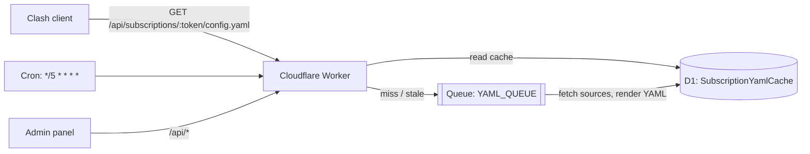

# SubBoost CF

> Self-hosted Clash / Mihomo subscription converter and manager running on **Cloudflare Workers + D1 + Queues** — no server, no managed database, and it fits in the free tier.

[](LICENSE)
[](https://developers.cloudflare.com/workers/)

SubBoost started as a Next.js + PostgreSQL self-hosted subscription service. This repository is the **Cloudflare edition**: Workers instead of a server, D1 (SQLite) instead of PostgreSQL, Queues + Cron instead of background jobs, with the full management UI preserved.

- Chinese README: [README.md](README.md) · Deployment: [docs/CLOUDFLARE_DEPLOY.md](docs/CLOUDFLARE_DEPLOY.md) / [English](docs/CLOUDFLARE_DEPLOY.en.md)
- Origin and change notice: [NOTICE.md](NOTICE.md)

## What it does

Feed it airport or self-hosted subscription URLs, and it gives you back **one stable subscription URL**. Clients (Clash Verge, Mihomo, FlClash, Stash, …) subscribe to that single URL and receive a full YAML config with your own proxy groups, rules and DNS settings.

## Features

- Imports Clash / Mihomo YAML, base64 node lists and single node links (ss, vmess, vless, trojan, hysteria2, tuic)
- Up to 10 sources per subscription; nodes keep source order, duplicates are renamed deterministically
- Emits standard Clash/Mihomo YAML with `subscription-userinfo` (traffic, expiry) headers
- Traffic fallback: when a source only reports remaining quota, totals are inferred instead of showing 0
- Optional stripping of speed-test snapshots from node names (`[63ms 21.18Mbps]`), so renamed nodes no longer break the client's selected proxy
- 14 built-in group modules (select, auto, ads, private, China, non-China, AI, YouTube, Google, Microsoft, Apple, GitHub, Telegram, final), each toggleable
- Advanced per-group filters evaluated in order: sources → regions → include regex → exclude regex
- Region groups matched by node-name keywords; custom groups and custom rules pointing at any group
- Rule providers with configurable base URL (swap GitHub raw for a jsDelivr mirror), refresh interval and proxy group
- Chain proxies (dialer-proxy) and group listeners
- Single administrator with optional TOTP; first-run setup via one-time token
- Asynchronous YAML generation: D1 cache + Queues, cron refresh every 5 minutes, manual refresh, retry and recovery
- Responsive Chinese UI (desktop and mobile), light and dark themes

## Architecture



- Worker (`local/cloudflare/worker.ts`): routing, auth, subscription endpoints, static assets, queue consumer, cron entry.
- D1: all business data plus the YAML cache; migrations live in `local/cloudflare/migrations/`.
- Queues: YAML rendering, source import and manual refresh run off the request path.
- Generation logic is pure and lives in `packages/core` (`server-core` handles fetching and traffic info, `ui` the React components).

## Deploy your own instance

Requirements: a Cloudflare account with Workers / D1 / Queues, Node.js `>=22.13.0 <23 || >=24.0.0`, Git, and `npx wrangler login`.

```bash
git clone https://github.com/wahaha1024/subboost-cf.git
cd subboost-cf
npm ci

npx wrangler d1 create subboost-my-instance
npx wrangler queues create subboost-my-instance-jobs

cp local/wrangler.example.jsonc local/wrangler.production.jsonc
# set name / database_name / database_id / queue names to your own values
cd local
node scripts/create-cloudflare-secrets.mjs production https://sub.example.com
npm run build:vinext
npx wrangler d1 migrations apply subboost-my-instance --remote --config wrangler.production.jsonc
npx wrangler deploy --config wrangler.production.jsonc --secrets-file .production-secrets
```

Then open `https://sub.example.com/login#setup-token=<LOCAL_SETUP_TOKEN>` to create the administrator (password at least 10 characters). The token is single-use.

Always build with `npm run build:vinext` (vinext). `npm run build` (`next build`) does not produce `dist/client` and deployment fails with `The directory specified by the "assets.directory" field does not exist`.

### Custom domain

Add a route to `local/wrangler.production.jsonc` and redeploy:

```jsonc
{ "routes": [{ "pattern": "sub.example.com", "custom_domain": true }] }
```

Then update the `APP_URL` secret to that origin and deploy again — subscription URLs are built from `APP_URL`. Once a custom domain is bound, `*.workers.dev` returns 404 by design.

### Secrets

`JWT_SECRET` (session signing), `AUTH_PEPPER` (password hashing), `ENCRYPTION_KEY` (encrypted columns), `LOCAL_SETUP_TOKEN` (one-time admin setup), `APP_URL` (public origin). Keep `local/.production-secrets` offline and never commit it.

Build-time variable `NEXT_PUBLIC_SOURCE_REPOSITORY_URL` points the footer "source (AGPL)" link at your own repository — required when you deploy a modified version.

## Local development

```bash
npm ci
npm --prefix local run dev:vinext   # vinext dev server (Cloudflare path)
npm run lint
npm --prefix local run typecheck
npm run test:unit
npm run test:core
```

## Subscription cache behaviour

YAML is generated asynchronously and cached in D1 (table `SubscriptionYamlCache`), keyed on the subscription's `updatedAt`. Saving a subscription invalidates the cache; changing generator code requires saving a subscription once before the new output appears. Responses are `cache-control: no-store`, but edges may still serve the previous version briefly — append `?ts=<timestamp>` while debugging. Only Clash-family user agents receive `Subscription-Userinfo` from some providers; a source can set `userinfoUserAgent` explicitly.

## Limits

100 nodes per subscription, 20 subscriptions per instance, 10 sources per subscription.

## Security

Passwords are bcrypt-hashed with a global pepper, sessions use signed JWTs, sensitive source fields are encrypted with `ENCRYPTION_KEY`. There is a single administrator account and no public sign-up. Use a long random password, enable TOTP, and consider Cloudflare Access in front of the panel.

## Contributing

Issues and pull requests are welcome. See [docs/CONTRIBUTING.md](docs/CONTRIBUTING.md): one concern per PR, no secrets or personal config, no version bumps, keep both READMEs in sync.

## License and credits

Distributed under [GNU AGPL-3.0-only](LICENSE).

Upstream chain: [SubBoost/subboost](https://github.com/SubBoost/subboost) (original project) → [ccawmiku/subboost-cf-personal](https://github.com/ccawmiku/subboost-cf-personal) (Cloudflare Workers / D1 / Queues edition) → [wahaha1024/subboost-cf](https://github.com/wahaha1024/subboost-cf) (this repository: further fixes for custom-group editing, first-paint login form, traffic double counting, source-ordered nodes, configurable rule-provider interval/proxy, and speed-snapshot stripping).

Keep the original copyright notices, `LICENSE`, [NOTICE.md](NOTICE.md) and [docs/THIRD_PARTY_NOTICES.md](docs/THIRD_PARTY_NOTICES.md). Under AGPL you must offer the source of the version you actually run — the footer link is that entry point; set `NEXT_PUBLIC_SOURCE_REPOSITORY_URL` to your own repository.

## Disclaimer

This project only converts and manages subscription formats. It ships **no nodes, no airport service and no credentials**. You are responsible for your sources and for complying with local laws and your providers' terms.
