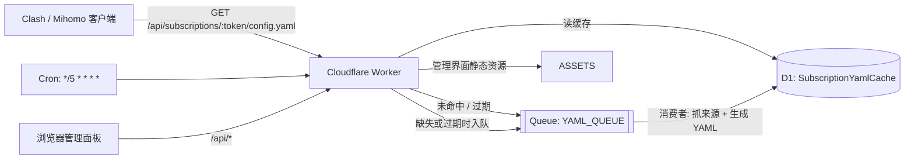

# SubBoost CF

> 自托管的 Clash / Mihomo 订阅转换与管理服务，运行在 **Cloudflare Workers + D1 + Queues** 上：没有服务器、没有数据库实例，免费额度即可跑起来。

[](LICENSE)
[](https://developers.cloudflare.com/workers/)
[](https://nextjs.org/)
[](https://www.typescriptlang.org/)

SubBoost 原本是一个 Next.js + PostgreSQL 的自托管订阅转换服务。本仓库是它的 **Cloudflare 版**：把运行时换成 Workers，把 PostgreSQL 换成 D1（SQLite），把后台任务换成 Queues + Cron，并保留完整的中文管理界面。

- 中文文档：本文件 · English: [README.en.md](README.en.md)
- 部署细节：[docs/CLOUDFLARE_DEPLOY.md](docs/CLOUDFLARE_DEPLOY.md) · [English](docs/CLOUDFLARE_DEPLOY.en.md)
- 来源与变更声明：[NOTICE.md](NOTICE.md) · 贡献约定：[docs/CONTRIBUTING.md](docs/CONTRIBUTING.md)

---

## 目录

- [它能做什么](#它能做什么)
- [功能特性](#功能特性)
- [架构](#架构)
- [部署到你自己的 Cloudflare 账号](#部署到你自己的-cloudflare-账号)
- [本地开发与测试](#本地开发与测试)
- [目录结构](#目录结构)
- [配置项说明](#配置项说明)
- [订阅生成与缓存行为](#订阅生成与缓存行为)
- [HTTP API 一览](#http-api-一览)
- [使用限制](#使用限制)
- [常见问题](#常见问题)
- [安全说明](#安全说明)
- [贡献](#贡献)
- [许可证与致谢](#许可证与致谢)
- [免责声明](#免责声明)

---

## 它能做什么

你把机场 / 自建节点的订阅链接交给它，它输出一条**稳定不变的订阅 URL**——客户端（Clash Verge、Mihomo、FlClash、Stash 等）只要订阅这一条，就能拿到经过你自定义分组、规则、DNS 的完整 YAML 配置。

典型用法：

1. 导入来源（机场订阅链接、Clash YAML、单节点链接均可）。
2. 在网页里选模板、勾选代理组模块、配置地区组 / 正则筛选 / 自定义分组 / 自定义规则。
3. 复制订阅地址，粘进客户端。
4. 之后无论换节点、改分组还是换规则，只改服务端配置，客户端点一次「更新订阅」即可。

## 功能特性

**订阅转换**

- 解析 Clash / Mihomo YAML、base64 节点列表、单条节点链接（ss / vmess / vless / trojan / hysteria2 / tuic 等）
- 多来源合并：一条订阅最多 10 个来源，节点按**来源顺序**输出，跨源同名节点自动去重并稳定重命名
- 输出标准 Clash/Mihomo YAML，附 `subscription-userinfo`（流量、到期）等响应头
- 流量信息解析：优先读来源的 `Subscription-Userinfo`；来源只给「剩余流量」时回退推算总量，避免面板显示为 0
- 节点名可选剥离测速快照（`[63ms 21.18Mbps]` 这类括号段），避免机场每次刷新改名导致客户端选中项失配

**代理组与规则**

- 14 个内置模块分组：节点选择 / 自动选择 / 广告拦截 / 私有网络 / 国内服务 / 非中国 / AI 服务 / 油管 / 谷歌 / 微软 / 苹果 / 代码托管 / 电报 / 漏网之鱼，可逐项开关
- 高级筛选（作用于「节点」成员）：来源过滤 → 地区过滤 → 包含正则 → 排除正则，四级顺序生效
- 地区组按节点名关键词匹配（香港 / 日本 / 新加坡 / 美国 …），可自定义组类型（select / url-test / fallback）与测速参数
- 自定义分组 + 自定义规则（DOMAIN / DOMAIN-SUFFIX / DOMAIN-KEYWORD / IP-CIDR / PROCESS-NAME / RULE-SET 等），规则可指向任意分组
- 规则集支持自定义基址（默认 GitHub raw，国内可换 jsDelivr 镜像）、自定义间隔、可指定拉取规则集时使用的代理组
- 链式代理（dialer-proxy）与组监听（group listeners）

**运行与管理**

- 单管理员账户 + 可选 TOTP 两步验证；管理员初始化走一次性令牌，不暴露注册入口
- 订阅 YAML 异步生成：Queues + D1 缓存，请求命中缓存直接返回，cron 每 5 分钟巡检刷新
- 手动刷新、自动更新间隔、失败重试与恢复
- 响应式中文界面（桌面 / 移动），深浅色主题

## 架构



- **Worker**（`local/cloudflare/worker.ts`）：路由、鉴权、订阅端点、静态资源绑定、Queue 消费者与 cron 入口。
- **D1**：全部业务数据（用户、来源、订阅、规则目录、YAML 缓存、限流计数）。迁移在 `local/cloudflare/migrations/`。
- **Queues**：YAML 生成、来源导入、手动刷新等耗时任务，避免在请求里同步抓取多个机场。
- **Cron**（`*/5 * * * *`）：按自动更新间隔巡检订阅，过期即重新入队。

生成逻辑是**纯函数**，与运行时无关，都在 `packages/core`：

| 包 | 职责 |
| --- | --- |
| `packages/core` | 解析来源、生成 Clash 配置、规则与代理组装配、节点名处理；无 I/O，可直接单测 |
| `packages/server-core` | 服务端共享逻辑：来源抓取、UA 回退、流量信息解析、节点快照刷新 |
| `packages/ui` | React 组件与页面级 UI（配置生成器、订阅管理、登录） |
| `packages/config` | 构建期共享配置 |
| `local` | Next.js 16 App Router 应用 + vinext 构建 + Cloudflare 适配层 |

## 部署到你自己的 Cloudflare 账号

**前置条件**

- 一个 Cloudflare 账号，Workers / D1 / Queues 可用（免费套餐足以跑个人实例，额度以 Cloudflare 当前文档为准）
- Node.js `>=22.13.0 <23 || >=24.0.0`、Git、npm
- 已登录的 wrangler：`npx wrangler login`

**1. 取得代码并安装依赖**

```bash
git clone https://github.com/wahaha1024/subboost-cf.git
cd subboost-cf
npm ci
```

**2. 创建独立资源**（名称自定，下文以 `subboost-my-instance` 为例）

```bash
npx wrangler d1 create subboost-my-instance
npx wrangler queues create subboost-my-instance-jobs
```

记下 D1 输出里的 `database_id`。

**3. 生成本实例的 wrangler 配置**

```bash
cp local/wrangler.example.jsonc local/wrangler.production.jsonc
```

把 `name`、`d1_databases[0].database_name`、`database_id`、`queues` 里的队列名改成上一步自己的值。

**4. 生成密钥**

```bash
cd local
node scripts/create-cloudflare-secrets.mjs production https://sub.example.com
```

会写出 `local/.production-secrets`（权限 0600）并打印一次性管理员设置地址。五项密钥含义见[配置项说明](#配置项说明)。

**5. 构建、迁移、部署**

```bash
cd local
npm run build:vinext
npx wrangler d1 migrations apply subboost-my-instance --remote --config wrangler.production.jsonc
npx wrangler deploy --config wrangler.production.jsonc --secrets-file .production-secrets
```

> 构建必须用 `npm run build:vinext`（vinext）。跑 `npm run build`（`next build`）会生成不了 `dist/client`，部署时报
> `The directory specified by the "assets.directory" field does not exist`。

**6. 创建管理员**

打开部署输出里的地址，或第 4 步打印的 `https://<你的域名>/login#setup-token=<LOCAL_SETUP_TOKEN>`，设置用户名与密码（密码至少 10 位）。令牌是一次性的，创建成功后即失效。

**7. 绑定自定义域名（可选但推荐）**

在 `local/wrangler.production.jsonc` 里加路由，然后重新部署：

```jsonc
{
  "routes": [{ "pattern": "sub.example.com", "custom_domain": true }]
}
```

绑定后把 `APP_URL` 密钥改成新域名，再部署一次——订阅地址是用 `APP_URL` 拼出来的：

```bash
python3 - <<'PY'
import json, pathlib
p = pathlib.Path(".production-secrets")
d = json.loads(p.read_text())
d["APP_URL"] = "https://sub.example.com"
p.write_text(json.dumps(d, indent=2))
PY
npx wrangler deploy --config wrangler.production.jsonc --secrets-file .production-secrets
```

> 绑定自定义域名后 `*.workers.dev` 会返回 404，这是 wrangler 关闭预览地址的正常行为。

## 本地开发与测试

```bash
npm ci

npm --prefix local run dev:vinext     # 本地起 vinext dev server（Cloudflare 适配路径）
npm --prefix local run dev            # 原版 Next.js 开发服务器（需要 PostgreSQL / Prisma）

npm run lint                          # ESLint + UI 一致性检查
npm --prefix local run typecheck      # tsc --noEmit
npm run test:unit                     # vitest 全量单测
npm run test:core                     # 只跑 packages/core 的纯逻辑测试
npm run test:coverage                 # 覆盖率报告
```

提交前建议至少跑 `npm run lint` 与 `npm run test:unit`。

## 目录结构

```text
.
├── local/                      # Next.js 16 应用 + Cloudflare 适配
│   ├── app/                    # App Router 路由（(site) 路由组 = 页面，api/ = 接口）
│   ├── src/                    # 客户端组件、状态、请求封装
│   ├── cloudflare/
│   │   ├── worker.ts           # Worker 入口：fetch / queue / scheduled
│   │   ├── migrations/         # D1 迁移 SQL
│   │   └── *.ts                # D1 仓储、YAML 投递、限流等
│   ├── scripts/                # 密钥生成、冒烟测试、构建辅助
│   ├── wrangler.example.jsonc  # 部署配置模板
│   └── wrangler.production.jsonc  # 你的实例配置（不入库）
├── packages/
│   ├── core/                   # 纯逻辑：解析、生成、规则、分组、节点名
│   ├── server-core/            # 服务端共享：抓取、流量信息、快照刷新
│   ├── ui/                     # React 组件与配置生成器 UI
│   └── config/
├── docs/                       # 部署指南、贡献约定、第三方声明
├── scripts/                    # 仓库级脚本
├── test/                       # 跨包集成测试
└── NOTICE.md / LICENSE
```

## 配置项说明

### 五项密钥（`local/scripts/create-cloudflare-secrets.mjs` 生成）

| 名称 | 用途 |
| --- | --- |
| `JWT_SECRET` | 会话 JWT 签名 |
| `AUTH_PEPPER` | 密码哈希的全局 pepper |
| `ENCRYPTION_KEY` | 加密存储敏感字段（来源 token 等） |
| `LOCAL_SETUP_TOKEN` | 一次性管理员初始化令牌（`/login#setup-token=…`） |
| `APP_URL` | 站点公开地址，决定订阅链接与页脚链接的域名 |

`.production-secrets` 请自行离线备份，**不要提交**（已在 `.gitignore` 中忽略）。

### 构建期变量

| 变量 | 说明 |
| --- | --- |
| `NEXT_PUBLIC_SOURCE_REPOSITORY_URL` | 页脚「本版本源码 (AGPL)」链接。按 AGPL 要求，部署并向他人提供服务时应指向**你实际运行的版本**的公开源码。 |

### 订阅级配置（面板可视编辑，也可直接改 API）

| 键 | 说明 |
| --- | --- |
| `ruleProviderBaseUrl` | 规则集基址。默认 `https://github.com/MetaCubeX/meta-rules-dat/raw/refs/heads/meta/geo`；国内拉不动时换成 `https://testingcf.jsdelivr.net/gh/MetaCubeX/meta-rules-dat@meta/geo` |
| `ruleProviderInterval` | 规则集刷新间隔（秒，≥60，默认 86400） |
| `ruleProviderProxy` | 拉取规则集时使用的代理组名（如 `⚡ 自动选择`）。Mihomo / Clash Verge 生效，部分客户端会忽略 |
| `dnsYaml` | 完整 DNS 段。给了就整段替换默认；`fake-ip` / `redir-host` 均可 |
| `nodeNameFilter` | 节点名排除正则，可用来滤掉机场塞进来的广告伪节点 |
| `proxyGroupAdvanced` | 逐组高级筛选：`sourceIds` / `regions` / `includeRegex` / `excludeRegex` / `groupType` / `strategy` |
| `customProxyGroups` / `customRules` | 自定义分组与自定义规则 |

## 订阅生成与缓存行为

- YAML **不是**每次请求实时生成。Worker 先查 D1 的 `SubscriptionYamlCache`，命中即返回；未命中或已过期才投递到 `YAML_QUEUE`，由消费者抓来源、生成、写回。
- 缓存有效性的锚点是订阅记录的 `updatedAt`：**改了订阅配置就相当于要求重生成**。改了 Worker 侧生成代码后，也要保存一次订阅才会重新生成。
- 缓存响应头是 `cache-control: no-store`，但边缘仍可能短时间返回上一版内容；调试时给订阅 URL 加 `?ts=<时间戳>` 可强制拿到新内容。
- 客户端兼容性：只有 Clash 系 UA（`clash.meta/1.19.24`、`Clash/v1.18.0` 等）才会从部分机场拿到 `Subscription-Userinfo` 头。来源可单独配置 `userinfoUserAgent` 来指定抓流量信息用的 UA。

## HTTP API 一览

| 方法与路径 | 说明 |
| --- | --- |
| `GET /api/health/live` | 存活探针 |
| `GET /api/health/ready` | 就绪探针（含 D1 连通性） |
| `POST /api/auth/login` | 管理员登录（密码 + 可选 TOTP） |
| `GET /api/auth/me` | 当前会话与初始化状态 |
| `POST /api/setup/admin` | 用一次性令牌创建管理员（需 `X-SubBoost-Setup-Token`） |
| `GET/POST /api/subscriptions` | 订阅列表 / 新建 |
| `GET/PUT/DELETE /api/subscriptions/:id` | 订阅详情 / 整份覆盖配置 / 删除 |
| `GET /api/subscriptions/:token/config.yaml` | **客户端订阅端点**，返回 YAML |
| `GET /api/releases/latest` | 版本检查（代理 GitHub Releases） |

## 使用限制

| 项目 | 上限 |
| --- | --- |
| 单条订阅节点数 | 100 |
| 单实例订阅数 | 20 |
| 单条订阅来源数 | 10 |

这些是内置的防滥用上限，超出会在导入/生成阶段被截断。

## 常见问题

**部署时报 `assets.directory` 不存在？**
用了 `next build`。改用 `npm --prefix local run build:vinext`。

**`wrangler deploy` 报 `fetch failed` 或代理相关错误？**
先 `unset HTTPS_PROXY HTTP_PROXY ALL_PROXY` 再直连部署；Cloudflare API 走本地代理常被 TLS 层截断。

**部署成功但 `*.workers.dev` 返回 404？**
绑了自定义域名后 wrangler 会关闭预览地址，用你的域名访问。

**管理面板刚保存的配置，订阅里没生效？**
见[订阅生成与缓存行为](#订阅生成与缓存行为)：等一次队列生成，或用 `?ts=` 拉新的。

**订阅里没有流量信息 / 显示 0？**
来源可能只对 Clash 系 UA 返回 `Subscription-Userinfo`。给该来源设置 `userinfoUserAgent`，或在文本型信息节点里保留「剩余流量：…」这类节点让服务端回退解析。

**规则集一直拉取失败？**
把 `ruleProviderBaseUrl` 换成 jsDelivr 镜像，并给 `ruleProviderProxy` 指定一个可用的 `url-test` 组。

**生成的配置能不能先校验？**
`mihomo -t -d /tmp/test -f your-config.yaml`，返回 `configuration file test is successful` 即语法通过。

## 安全说明

- 密码以 bcrypt 哈希 + 全局 pepper 存储；会话使用签名 JWT；敏感来源字段用 `ENCRYPTION_KEY` 加密后入库。
- 只有一个管理员账户，没有公开注册；初始化依赖一次性令牌，创建后失效。
- 建议：使用长随机密码并开启 TOTP；对外暴露时再加一层 Cloudflare Access 或 WAF 规则；`.production-secrets` 与 `wrangler.production.jsonc` 永不入库。
- 部署者需自行确认所在地区对相关服务的法律与合规要求。

## 贡献

欢迎 issue 与 PR。约定见 [docs/CONTRIBUTING.md](docs/CONTRIBUTING.md)：一个 PR 只做一件事、不提交机密或个人配置、不 bump 版本号、README 中英文同步更新。

## 许可证与致谢

本项目以 [GNU AGPL-3.0-only](LICENSE) 分发。

来源链（自上游到本仓库）：

1. [SubBoost/subboost](https://github.com/SubBoost/subboost) — 原版 SubBoost，Next.js + PostgreSQL 自托管订阅转换服务，原作者。
2. [ccawmiku/subboost-cf-personal](https://github.com/ccawmiku/subboost-cf-personal) — Cloudflare Workers / D1 / Queues 改版、单管理员账户、个人版界面与部署文档。
3. **本仓库** [wahaha1024/subboost-cf](https://github.com/wahaha1024/subboost-cf) — 在 (2) 的基础上继续修复与增强：自定义分组规则区不再顶掉节点编辑、登录页首屏直接渲染表单、流量信息不再重复累加、节点按来源顺序输出、规则集间隔与代理可配置、节点名自动剥离测速快照。

原版权声明、`LICENSE`、[NOTICE.md](NOTICE.md) 与 [docs/THIRD_PARTY_NOTICES.md](docs/THIRD_PARTY_NOTICES.md) 必须保留。**AGPL 义务**：修改并通过网络向他人提供服务时，必须在界面中提供你所运行版本的对应源码——页脚「本版本源码 (AGPL)」即入口，用 `NEXT_PUBLIC_SOURCE_REPOSITORY_URL` 指向你自己的仓库。

## 免责声明

本项目只做订阅格式转换与配置管理，**不提供任何节点、机场或网络服务**，仓库内不含任何可用订阅地址或凭据。使用者需自行准备来源，并自行承担遵守所在地法律法规及所使用服务商条款的责任。
